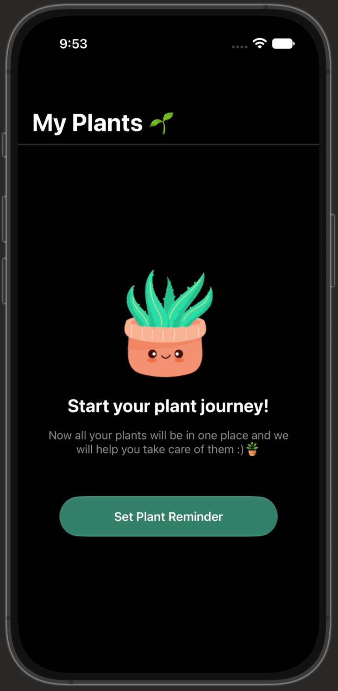
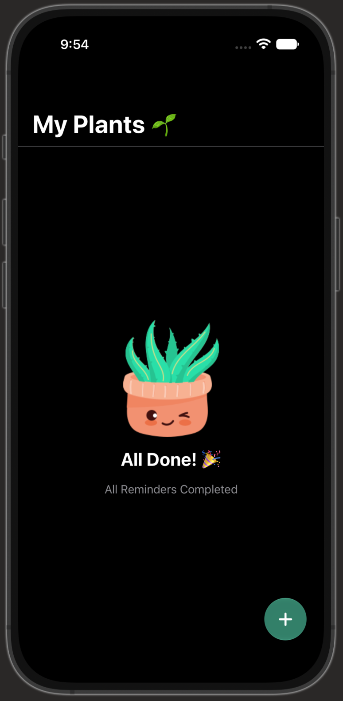
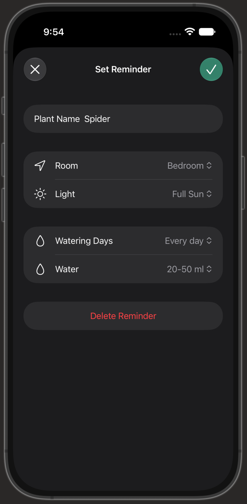

  

<h1 align="center">Planto 🌱</h1>

A simple iOS app that reminds you to water your plants.

A simple iOS app that reminds you to water your plants.

## Features:
- Add plants with name, room, light, watering days, and water amount
- Check plants when you water them
- Local notifications based on each plant's watering schedule
- Progress bar showing how many plants are watered today
- Edit or delete plants

## Screenshots

  
  
  
  
  

## 🛠️ Tools & Technologies

  
  
  
  
  
  

- **SwiftUI**: building the user interface
- **SwiftData**: saving plants on the device
- **UserNotifications**: watering reminders
- **MVVM**: organizing the code (Models, ViewModels, Views)
- **Icon Composer**: Liquid Glass app icon
